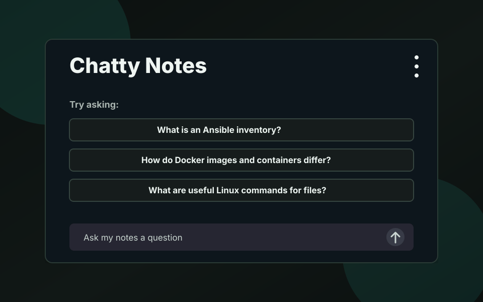
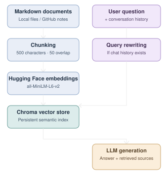

# Chatty Notes

[](https://github.com/ditek/notes-chat/actions/workflows/ruff-check.yaml)
[](https://diaa.dev/notes)

Chatty Notes is a conversational Retrieval-Augmented Generation (RAG) application for querying text documents using natural language. I use it for my markdown notes, but it works with any text-based documents. PDF support is planned.

It combines semantic search with an LLM to retrieve relevant information, generate context-aware answers, and expose the source passages used.



## Key Features

- **Conversational retrieval:** Rewrites follow-up questions into standalone search queries using conversation history.
- **Semantic search:** Uses Hugging Face embeddings and Chroma for similarity-based retrieval.
- **Document indexing:** Splits documents into overlapping chunks with source metadata.
- **Grounded generation:** Instructs the LLM to answer using retrieved context and acknowledge missing information.
- **Source inspection:** Displays retrieved passages, filenames, chunk IDs, and retrieval queries.
- **Multiple interfaces:** Provides a Streamlit UI, FastAPI endpoints, and CLI access.

## Operation


The current flow is:

1. Sync markdown notes from `github.com/ditek/Notes` (can be changed in the `.env` file) or use local files in `notes/`.
2. Split notes into chunks with LangChain's text splitter.
3. Embed chunks with `all-MiniLM-L6-v2`.
4. Store vectors in Chroma.
5. Retrieve relevant chunks for each question with top-k similarity retrieval.
6. Rewrite follow-up questions using chat history.
7. Generate answer with an appropriate LLM (currently using Qwen3-4B).

## Setup
After cloning, run these commands.

```bash
uv sync --locked
uv run pre-commit install
cp .env.example .env
```

Edit `.env` and set a Hugging Face token with at least this permission:

```text
Make calls to Inference Providers
```

## Usage
### Sync Notes

Download notes from a public git repo (specified in `NOTES_REPO_CONTENTS_URL`):

```bash
uv run main.py sync-notes
```

Download and rebuild the vector index:

```bash
uv run main.py sync-notes --index
```

You can also index whatever markdown files are already in `notes/`:

```bash
uv run main.py index --reset
```

### Ask From The CLI

```bash
uv run main.py ask "What is an Ansible inventory?" --k 3
```

### Run The Streamlit App

```bash
uv run streamlit run app.py
```

The app includes:

- chat history
- query rewriting for follow-up questions
- source chunk display
- a `k` slider for retrieved chunks
- buttons to sync notes, rebuild the index, reload the index, and clear chat

### Run The FastAPI App

```bash
uv run uvicorn api:app --reload --port 8000
```

Ask a question:

```bash
curl -X POST http://localhost:8000/ask \
  -H "Content-Type: application/json" \
  -d '{
    "question": "What is an Ansible inventory?",
    "k": 3,
    "chat_history": []
  }'
```

The response includes:

- `answer`
- `retrieval_query`
- `sources`

Admin endpoints are disabled unless `API_ADMIN_TOKEN` is set. When enabled, call them with:

```bash
Authorization: Bearer your_admin_token
```

Available admin endpoints:

- `POST /admin/sync-notes`
- `POST /admin/index`

### Environment Variables

- Set `HF_TOKEN` to allow communication with Hugging Face. Only `Make calls to Inference Providers` permission is needed for that.
- Set `CHROMA_DIR=./chroma_db` for local development.
- Set `API_ALLOWED_ORIGINS` to a comma-separated list of browser origins allowed to call the FastAPI app. It defaults to `*`.
- Set `API_ADMIN_TOKEN` only if you want to enable protected sync/index endpoints.
- Keep `ENABLE_SIDEBAR_CONTROLS=false` to hide the sidebar in public embeds.
- Set `DEFAULT_RETRIEVAL_K` to control how many chunks are retrieved when the sidebar is hidden.

### Deployments

Deployment-specific files live under `deploy/`.

For deploying to Hugging Face Spaces, see:

```bash
deploy/huggingface/README.md
```
